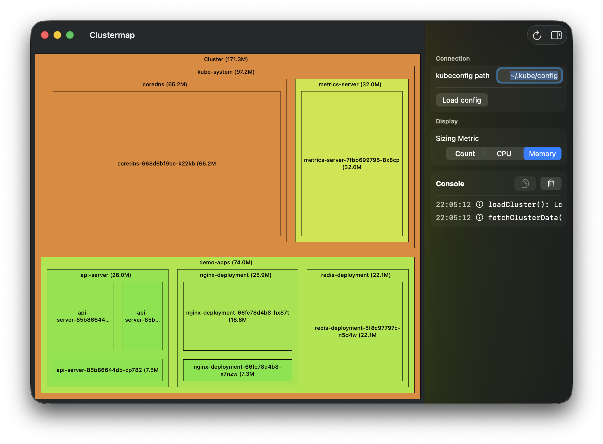

# Clustermap

A native macOS application that visualizes Kubernetes cluster resources using interactive treemaps. Built with SwiftUI, Clustermap provides an intuitive way to understand resource allocation, usage patterns, and cluster topology at a glance.

