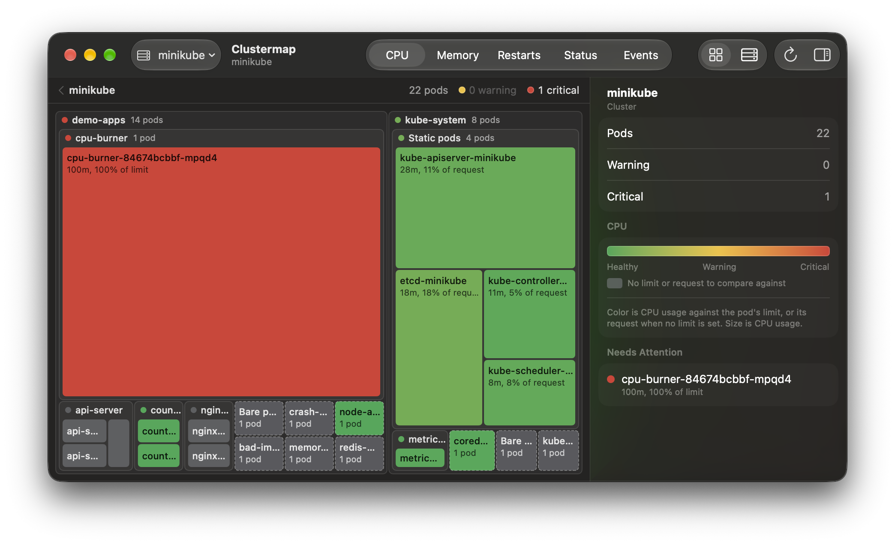

# Clustermap

Kubernetes cluster health at a glance.

Clustermap is a native macOS app that draws every pod in a cluster as a tile in a treemap. Tile size is the pod's footprint. Tile color is its health. Trouble stands out without reading a single table.



## Health signals

Pick a signal in the toolbar. The map recolors.

| Signal | Color shows | Tile size |
| --- | --- | --- |
| CPU | Usage against the pod's limit (or its request) | CPU usage |
| Memory | Usage against the pod's limit (or its request) | Memory usage |
| Restarts | Restart count of pods that restarted in the last hour | Equal |
| Status | Running, pending or not ready, failing (CrashLoopBackOff, ImagePullBackOff, OOMKilled) | Equal |
| Events | Warning events in the last hour | Equal |

- A group takes the color of its worst pod, so one failing pod is visible from the top level.
- Gray tiles have nothing to compare against: no limit and no request, or no metrics yet.

## Using it

- Clustermap reads `~/.kube/config` and its current context on launch. No setup.
- The map refreshes every 30 seconds.
- Switch context from the toolbar.
- Group pods by namespace and workload, or by node.
- Click a group to zoom in. Press Escape to zoom out.
- Click a pod to see all five signals, its containers, and its recent warning events in the sidebar.

## Settings

- Kubeconfig file and refresh interval.
- Color scheme: Classic, Colorblind Safe, Viridis, Heat, or Mono.
- Thresholds for warning and critical.

## Requirements

- macOS 15.5 or later, Apple Silicon.
- A kubeconfig that can list pods and events in all namespaces. Clustermap only reads.
- The [Metrics Server](https://github.com/kubernetes-sigs/metrics-server) for CPU and memory. The other signals work without it.
- Token, client certificate, and exec plugin logins (GKE, EKS, AKS) are supported.

## Install

Download `Clustermap.dmg` from the [latest release](https://github.com/nvictor/clustermap/releases/latest). The app updates itself.

## Build

```bash
swift test --package-path ClustermapCore
```

```bash
xcodebuild -project Clustermap/Clustermap.xcodeproj -scheme Clustermap -destination 'platform=macOS,arch=arm64' CODE_SIGNING_ALLOWED=NO build
```

- `ClustermapCore` holds the Kubernetes client, the health model, and the treemap layout. It has no UI and is covered by tests.
- `Clustermap` is the SwiftUI app.
- Launch the app with `--demo` to see a made-up cluster without connecting to a real one.
- `sh/deploy.sh` fills a test cluster with healthy and broken workloads.
